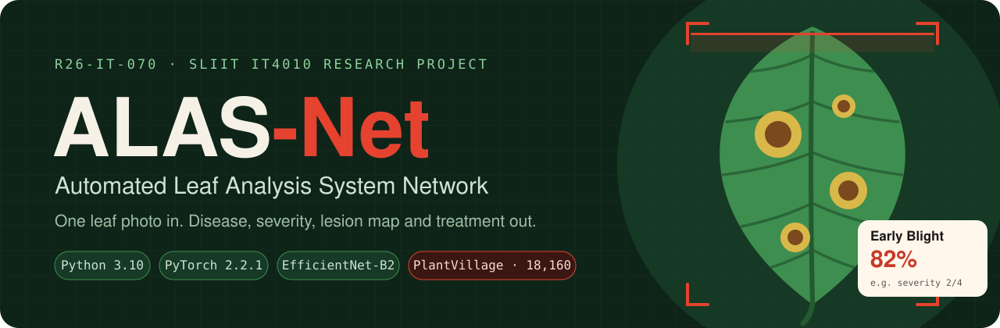
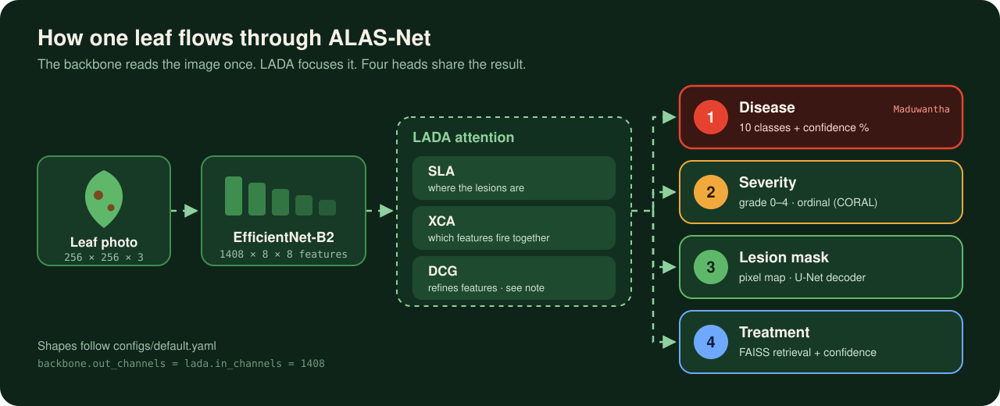
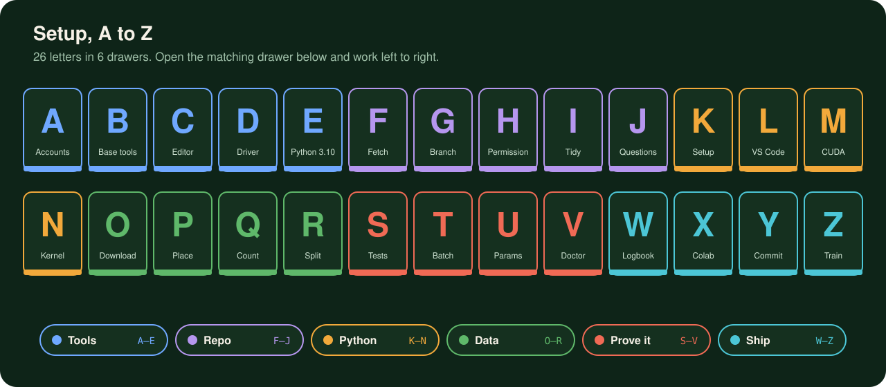
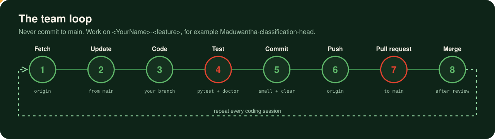

<div align="center">




[What it does](#-what-alas-net-does) ·
[Quick start](#-quick-start-for-team-members) ·
[A–Z setup](#-full-setup-a-to-z) ·
[Repo map](#-repo-map) ·
[Team workflow](#-team-workflow) ·
[Troubleshooting](#-troubleshooting)

</div>

---

## 🌱 Why this exists

Tomato diseases like Early Blight, Bacterial Spot and Mosaic Virus can wipe out **20–40% of a season's harvest**. Most small-scale farmers can't get to a plant pathologist in time. Existing apps name the disease and stop there.

ALAS-Net answers the four questions a farmer actually has, from **one photo** and **one shared model**:

| ❓ The farmer asks | 🧠 ALAS-Net head | 📤 Output |
|---|---|---|
| *What is it?* | **Head 1 · Disease classification** | 1 of 10 classes + a confidence % (e.g. *Early Blight 82%*) |
| *How bad is it?* | **Head 2 · Severity estimation** | Grade 0 (healthy) → 4 (severe), ordinal-aware |
| *Where is it?* | **Head 3 · Lesion segmentation** | Pixel mask of the diseased area |
| *What do I do?* | **Head 4 · Treatment recommendation** | Retrieved treatment + confidence, with a flag when unsure |

> 🌍 Supports **SDG 1** (No Poverty), **SDG 2** (Zero Hunger), **SDG 12** (Responsible Production) and **SDG 15** (Life on Land).

---

## 🧠 What ALAS-Net does



The image is read **once** by the backbone. The **LADA** attention module (SLA → XCA → DCG) sharpens the features, and all four heads read the same focused feature map.

### 🔬 The LADA module: code vs proposal

| Block | What the code does today (`lada/modules/`) | What the proposal describes |
|---|---|---|
| **SLA** | Squeeze-Linear Augmentation: a spatial 7×7 conv plus a channel linear layer | Spatial Lesion Attention: *where* the lesions are |
| **XCA** | Cross-Channel Attention, 1408 → 352 → 1408, with a residual | Cross-Covariance Channel Attention: *which* features fire together |
| **DCG** | Dense Connection Group: 3 densely connected conv layers + residual | **Disease-Conditional Gate**: re-weights channels by the likely disease (the main novelty) |

> ⚠️ **Team note:** the DCG in the code and the DCG in the proposal are different ideas. Agree on the final version before the progress presentations, because examiners compare the code with the proposal.

---

## 📊 The data

**PlantVillage, tomato subset:** 10 classes, **18,160** colour images. The dataset is badly imbalanced:



- **Split:** 70 / 15 / 15, stratified per class, seed 42 (`preprocessing/scripts/split_dataset.py`)
- **Imbalance tools:** a `WeightedRandomSampler` (dataloader) and focal loss (training). ⚠️ Use **one at a time**, because both together over-correct.
- **Images never go into git.** Every member downloads them once (see letters **O–R** below).

---

## ⚡ Quick start for team members

> Already set up once? This is all you need. New laptop? Do the [full A–Z](#-full-setup-a-to-z) instead.

```powershell
# 1 · go to the repo (Windows PowerShell)
cd "C:\path\to\R26-IT-070"

# 2 · build the environment: .venv + PyTorch 2.2.1 (GPU if found) + pinned packages + notebook kernel
.\tools\setup_env.ps1

# 3 · copy the 10 tomato classes from your unzipped Kaggle download
.\.venv\Scripts\Activate.ps1
python tools/get_plantvillage.py --source "$env:USERPROFILE\Downloads\plantvillage dataset"

# 4 · split, test, check
python preprocessing/scripts/split_dataset.py
python -m pytest -v
python tools/doctor.py        # 0 failures = ready 🎉
```

---

## 🔤 Full setup, A to Z



Six drawers, 26 letters. Open each one and work top to bottom. A printable copy lives in [`SETUP.md`](SETUP.md).

<details>
<summary><b>🧰 Tools · A–E</b> · accounts, Git, editor, driver, Python</summary>

| | Step | Do this | ✅ Works when |
|---|---|---|---|
| **A** | Accounts | GitHub account with access to `Deep-Learning-Models/R26-IT-070` · free Kaggle account | The repo page opens while you're signed in |
| **B** | Base tools | Install **Git** + **GitHub Desktop** → File → Options → Accounts → Sign in | `git --version` prints a version |
| **C** | Code editor | **VS Code** + the *Python* and *Jupyter* extensions | `code --version` works |
| **D** | Driver | Latest **NVIDIA driver**, then restart | `nvidia-smi` shows your GPU |
| **E** | Exact Python | **Python 3.10** from python.org, tick *Add to PATH* | `py -3.10 --version` → 3.10.x |

</details>

<details>
<summary><b>🐙 Repo · F–J</b> · fetch, branch, permissions, tidy, team questions</summary>

| | Step | Do this | ✅ Works when |
|---|---|---|---|
| **F** | Fetch | GitHub Desktop → **Fetch origin** → **Pull origin** on `main` | "Last fetched just now" |
| **G** | Git + branch | Options → Git (name + GitHub email) · **New branch** `<YourName>-<feature>` → **Publish** | Toolbar shows your branch |
| **H** | Hand permission | `Set-ExecutionPolicy -Scope CurrentUser RemoteSigned` (once) | `.ps1` scripts run |
| **I** | Inspect + tidy | `.\tools\cleanup.ps1` → review it in GitHub Desktop → commit | Only empty placeholders and stray images changed |
| **J** | Jot questions | Agree on the open team decisions ([below](#-open-team-decisions)) | Answers are in the logbook |

</details>

<details>
<summary><b>🐍 Python · K–N</b> · one-shot setup, VS Code, CUDA, notebooks</summary>

| | Step | Do this | ✅ Works when |
|---|---|---|---|
| **K** | Kick off | `.\tools\setup_env.ps1` (`-Cpu` if you have no NVIDIA GPU, `-Fresh` to rebuild) | Ends with "Setup finished" |
| **L** | Link VS Code | Ctrl+Shift+P → *Python: Select Interpreter* → `.venv` | The prompt shows `(.venv)` |
| **M** | Make CUDA work | `python -c "import torch; print(torch.cuda.is_available())"` | Prints `True` |
| **N** | Notebook kernel | In a notebook, choose the kernel **R26-IT-070 (.venv)** | Cells import torch |

</details>

<details>
<summary><b>🍅 Data · O–R</b> · download, place, count, split</summary>

| | Step | Do this | ✅ Works when |
|---|---|---|---|
| **O** | Obtain | Download [PlantVillage on Kaggle](https://www.kaggle.com/datasets/abdallahalidev/plantvillage-dataset) and unzip it **outside** the repo | You can see `color\Tomato___Early_blight` |
| **P** | Place | `python tools/get_plantvillage.py --source "<unzipped folder>"` | Every row says `ok`, total 18160 |
| **Q** | Quantity | `python tools/doctor.py` → Dataset section | 10 × `[ OK ]` |
| **R** | Run split | `python preprocessing/scripts/split_dataset.py` | "Split complete" → `data/split/` |

</details>

<details>
<summary><b>🧪 Prove it · S–V</b> · tests, a real batch, model size, doctor</summary>

| | Step | Do this | ✅ Works when |
|---|---|---|---|
| **S** | Sanity tests | `python -m pytest -v` | All tests pass |
| **T** | Test a batch | `python preprocessing/scripts/build_dataloader.py` | `torch.Size([32, 3, 256, 256])` |
| **U** | Understand size | `python calculate_params.py` | SLA / XCA / DCG parameter counts |
| **V** | Verify | `python tools/doctor.py` | `0 failures` |

</details>

<details>
<summary><b>🚀 Ship · W–Z</b> · logbook, Colab, first PR, start building</summary>

| | Step | Do this | ✅ Works when |
|---|---|---|---|
| **W** | Write logbook | Date, GPU, torch version, doctor result, problems and fixes | The entry is signed |
| **X** | eXtra GPU | Open `notebooks/03_train_colab.ipynb` in Colab (data on Drive, token prompt) | The doctor shows CUDA on Colab |
| **Y** | Your commit | Commit on your branch → **Push origin** → **Pull request** to `main` | A teammate is assigned as reviewer |
| **Z** | Zero to train | Start your head / module on the 1408-channel features | Green tests + green doctor |

</details>

### 🩺 What a healthy doctor looks like

```text
R26-IT-070 environment doctor
== Python ==================================================
[ OK ] Python 3.10  (3.10.11)
[ OK ] Running inside the repo's .venv
== GPU =====================================================
[ OK ] CUDA available  (NVIDIA GeForce RTX 3080, 10.0 GB VRAM, CUDA 12.1)
== Dataset =================================================
[ OK ] Total raw images  (18160 of 18,160)
[ OK ] data/split exists  (train …, val …, test …)
============================================================
… OK   0 warnings   0 failures
All green. Your environment is ready.
```
<sub>Example output: your GPU name, VRAM and counts will differ.</sub>

---

## 🗺️ Repo map

```text
R26-IT-070/
├── 📄 README.md               ← you are here
├── 📄 SETUP.md                ← printable A–Z checklist
├── 📄 requirements.txt        ← pinned versions (torch 2.2.1, albumentations 1.3.1 …)
├── ⚙️ configs/default.yaml    ← ONE place for every setting, never hard-code
├── 🧰 tools/                  ← setup_env.ps1 · doctor.py · get_plantvillage.py · cleanup.ps1
├── 🍃 preprocessing/          ← split · augment (+ CutMix) · dataloader · 8 tests
├── 🔬 lada/                   ← SLA · XCA · DCG · LADANet · 13 tests
├── 🏋️ training/               ← trainer + train.py (focal loss, AMP, checkpoints)
├── 💊 retrieval/              ← treatment knowledge base + FAISS (planned)
├── 📓 notebooks/              ← 03_train_colab.ipynb (Colab setup)
├── 🖼️ docs/                   ← class distribution + feature-map figures
├── 📱 tomato_guard/           ← Flutter mobile app (UI prototype)
└── 🚫 data/  checkpoints/  .venv/   ← git-ignored, never committed
```

### 📍 Where each head lives

| Head | Owner | Code | Status |
|---|---|---|---|
| Backbone + LADA | Aazim | `lada/modules/` | ✅ Built + 13 tests |
| Data pipeline | team | `preprocessing/scripts/` | ✅ Built + 8 tests |
| Training loop | team | `training/` | ✅ Built |
| **Head 1 · Disease** | **Maduwantha** | *agree: `src/heads.py` or next to `lada/`* | 🚧 In progress |
| Head 2 · Severity | *add name* | *planned* | 📝 Planned |
| Head 3 · Segmentation | *add name* | *planned* | 📝 Planned |
| Head 4 · Treatment | *add name* | `retrieval/` | 📝 Placeholders |
| Mobile app | *add name* | `tomato_guard/` | 🎨 UI prototype, model not connected yet |

<sub>✏️ Team: fill in the names and update the statuses as you go.</sub>

---

## 🤝 Team workflow



**🌿 Branches:** never commit to `main`. Name branches `<YourName>-<feature>`, e.g. `Aazim-lada-features`, `Maduwantha-classification-head`.

**✅ Before every pull request**
- [ ] `python -m pytest -v` passes
- [ ] `python tools/doctor.py` shows 0 failures
- [ ] No data, checkpoints or `.venv` in the Changes list
- [ ] Settings live in `configs/default.yaml`, not in your code
- [ ] A teammate is assigned as reviewer
- [ ] A logbook entry is written

**🚫 What never goes into git:** images, `data/`, `checkpoints/`, `*.pt` / `*.pth`, `.venv/`, `*.csv`, `*.json`. GitHub rejects files over 100 MB, and one bad commit is painful to undo.

---

## 🧭 Open team decisions

| # | Question | Why it matters |
|---|---|---|
| 1 | **EfficientNet-B2 (1408 ch, in code) or B0 (1280 ch, in proposal)?** | Every head's input size depends on it |
| 2 | **Which DCG:** Dense Connection Group (code) or Disease-Conditional Gate (proposal)? | It's the main novelty claim in the viva |
| 3 | **Sampler or focal-loss alpha** for imbalance? | Using both over-corrects |
| 4 | Keep or drop the empty `src/` files and `notebooks/04_inference_demo.ipynb`? | Avoid two homes for the same code |
| 5 | Where does each head's code live? | Prevents merge conflicts |

---

## 🛠️ Troubleshooting

| 😵 You see | 🩹 Do this |
|---|---|
| `running scripts is disabled on this system` | `Set-ExecutionPolicy -Scope CurrentUser RemoteSigned` (once) |
| `torch.cuda.is_available()` → `False` | Update the NVIDIA driver, then `.\tools\setup_env.ps1 -Fresh` |
| `No suitable Python runtime found` | Install Python **3.10** from python.org |
| `Raw dataset folder not found` | Run `tools/get_plantvillage.py` (letter **P**) first |
| `Loaded 0 images` | Run `split_dataset.py` (letter **R**) |
| `ModuleNotFoundError: lada` | Run commands from the **repo root** with `.venv` active |
| CUDA out of memory | Lower `dataloader.batch_size` to 16 in `configs/default.yaml`, or use Colab |
| Merge conflict | GitHub Desktop → *Open in Visual Studio Code* → choose the version to keep → *Continue merge* |

---

## 🎓 Academic context

| | |
|---|---|
| **Module** | IT4010 Research Project · BSc (Hons) IT · SLIIT |
| **Group** | R26-IT-070 |
| **Supervisor** | Dr. Nathali Silva |
| **Assessment** | Proposal 12% · PP1 15% · Paper 10% · PP2 18% · Website 2% · Final report 19% · Viva 20% · Logbook 4% |

### 📚 Key references
- Tan & Le (2019). *EfficientNet: Rethinking Model Scaling for CNNs.* ICML.
- Lin et al. (2017). *Focal Loss for Dense Object Detection.* ICCV.
- Ronneberger et al. (2015). *U-Net.* MICCAI.
- Cao et al. (2020). *Rank-Consistent Ordinal Regression (CORAL).* Pattern Recognition Letters.
- Johnson et al. (2019). *Billion-scale similarity search with GPUs (FAISS).* IEEE Trans. Big Data.
- Mohanty et al. (2016). *Using deep learning for image-based plant disease detection.* Frontiers in Plant Science.

---

<div align="center">

**Built with 🍅 by team R26-IT-070** · Academic project, please ask the team before reusing the code.

</div>
